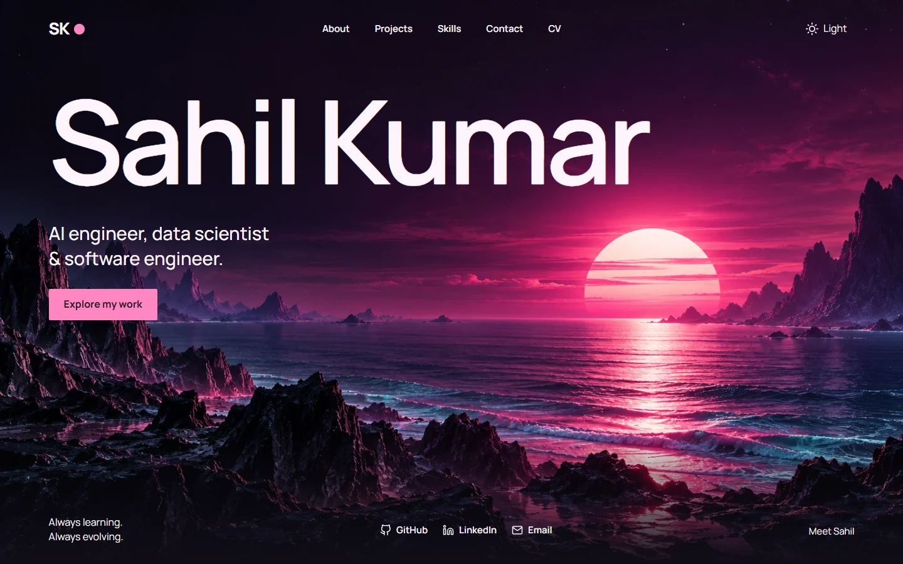
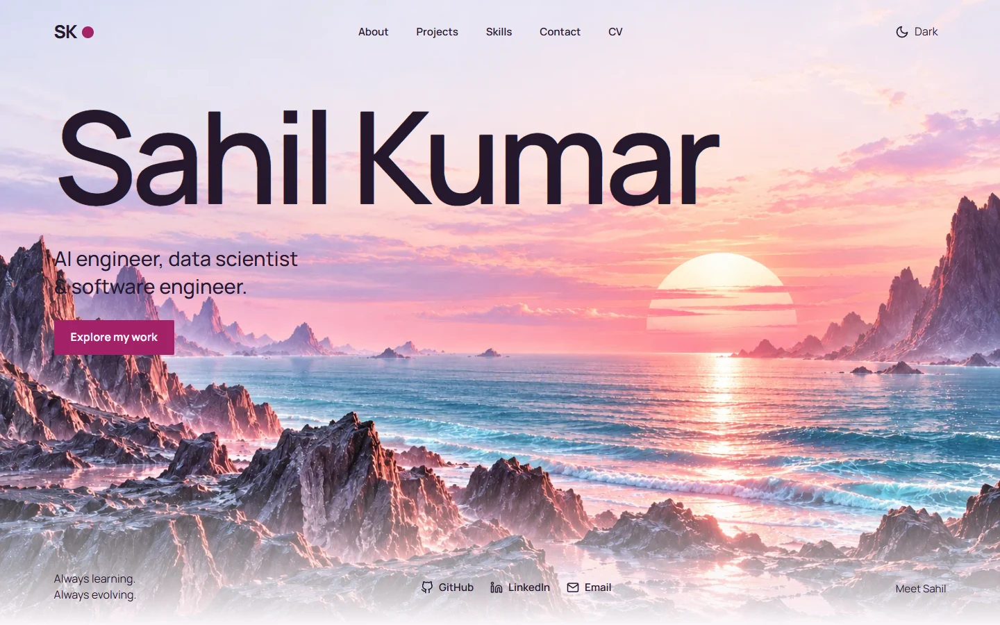

# Neon horizon portfolio redesign

The main portfolio now has an original night/dawn landscape, a large typographic opening, project-first navigation, readable project rows, native experience disclosures, a compact skill index, and an email-draft contact form. Trading Lab, Journal, report files, and project/experience/skill datasets are unchanged.

## Previews

## Design decisions

Design Taste dealt **The name as a monument**, seed **2004636226**, with no direction redraw. The composition was adapted to the user's expressly requested neon sun/horizon and light/dark pair. Manrope replaces the dealt Red Hat pair to use one self-hosted family throughout. Hallmark uses the user-specified custom aesthetic. Impeccable's direction service was unavailable; its seed was degraded, and the pinned user references governed the visual world.

Idea: **On this page, Sahil Kumar's name becomes the monument above an evolving horizon.** The live interaction is the light/dark switch: the same scene becomes dawn or night, alongside readable matching surfaces. Projects keep functioning category filters and load-more behavior.

The new artwork was generated with the built-in ImageGen tool, then converted to WebP. Original files ship at `public/images/horizon-dark.webp` and `public/images/horizon-light.webp`; the exact prompts are recorded in adjacent JSON provenance sidecars. No reference stock photo, stock watermark, or fabricated project screenshot ships. Manrope is self-hosted under the SIL Open Font License, included in `public/fonts/OFL-Manrope.txt`.

## Validation

- Production build succeeds. Existing Create React App/Browserslist warnings and the existing unused `DiC` import remain.
- 46 browser assertions pass across light/dark at 1440, 768, and 390px: theme, overflow, font/art loading, first-screen action, runtime exceptions, mobile menu/Escape, persistence, project filter/load-more, career disclosure/category, skill category, native required fields, and local destinations.
- Contact-handler test passes recipient, special-character encoding, multiline message and conditional status. No message was sent and no email app was opened during this isolated test.
- Existing gallery, session-visibility, report-session, and journal-insight checks pass. Two initial checks ran while the build was replacing output; those were rerun successfully after completion.
- Design Taste production inspection: 0 FAIL, 5 WARN, with explicit allowances for requested atmospheric palette/gradient and fewer than four pictures. Its remaining warnings concern type-size variety, no footage, custom font instead of dealt font, the deliberate landscape interlude, and a name-only-heading heuristic despite the visible engineering role sentence.
- Hallmark rendered inspection: 0 FAIL; one closed-native-details geometry reflex was independently reviewed as a false positive. Remaining advisories concern font-weight variety, short contact prose measure, varied internal column gaps, and retained content density.
- Impeccable detector: no findings in the requested scan.
- Independent final verdict: both required fixes resolved, SHIP for the finish gate. Scores: design 8/10, usability 8/10, creativity 8/10, content 7/10. This is a design judgment, not an accessibility certification.

## Remaining content limitations

Several existing demo links target `/coming-soon`; these now say **Demo coming soon**. One original GitHub source link uses `github.com/example/financial-analytics`. These destinations have been retained rather than replaced with invented work. Real screenshots or demos for the thesis and strongest projects would improve the body more than additional decorative imagery.

The contact form opens a draft in the visitor's email application. It does not send through a backend; its status explains that the application may not open and supplies the email address. The mobile CV destination now matches the existing `/CV.pdf`, fixing the old nonexistent `/CV-AI.pdf` link.

The live site has not been deployed or merged by this work.
